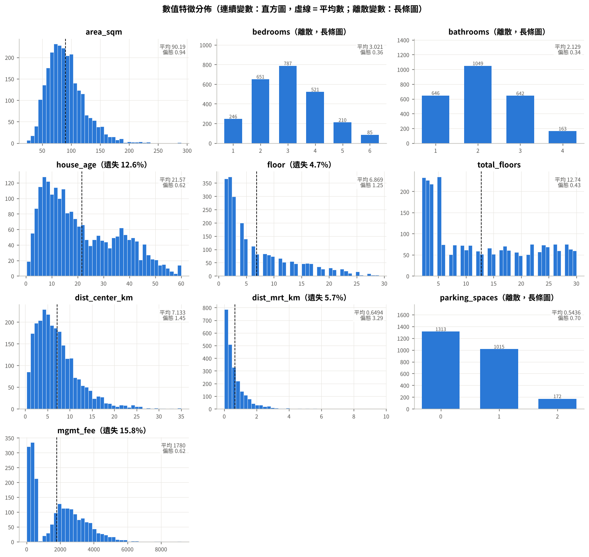
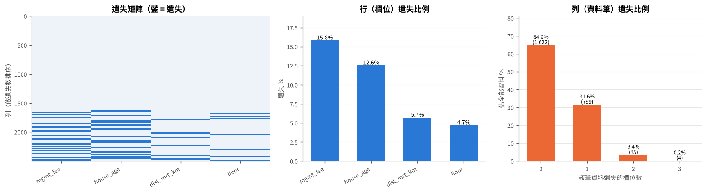
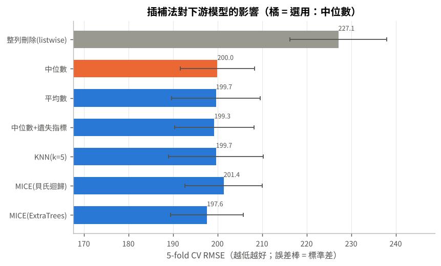
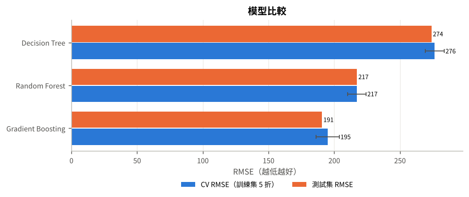
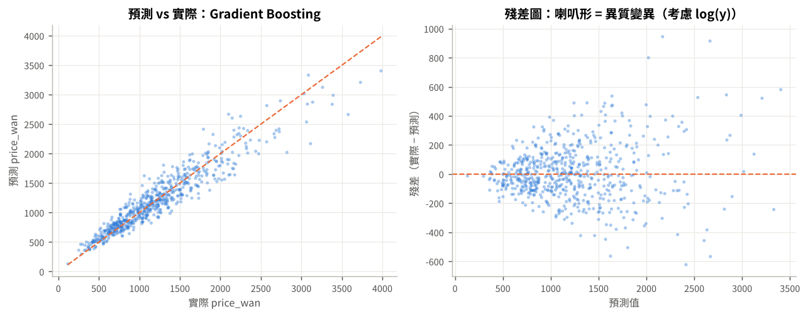
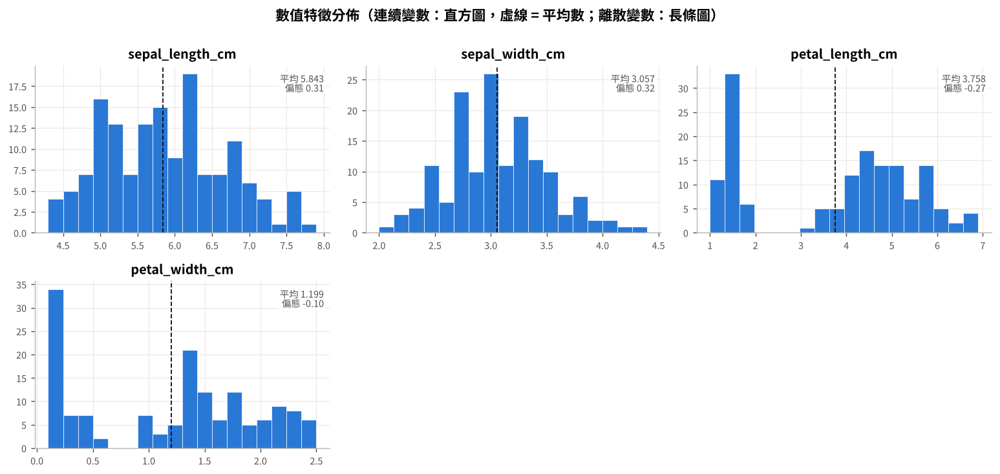
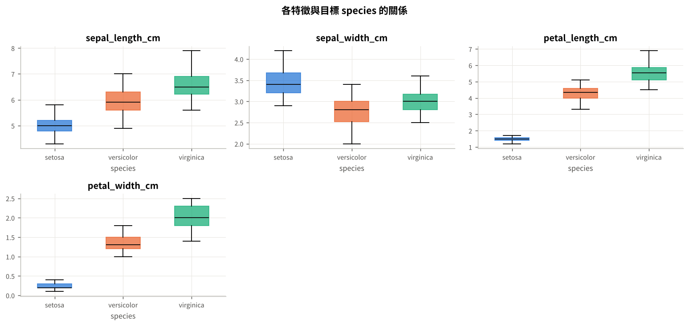
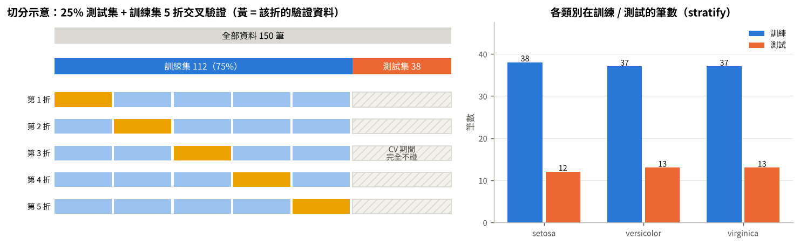
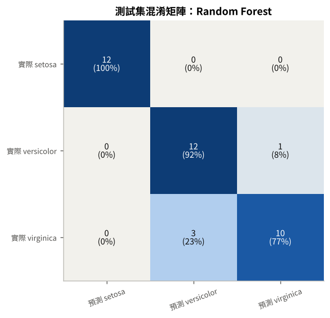
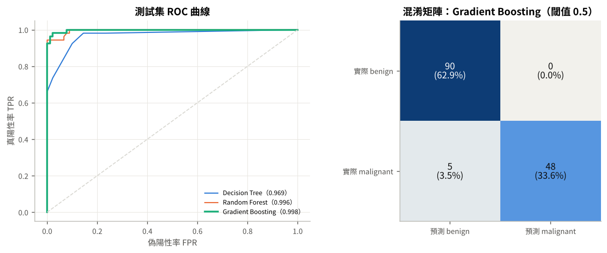

# 摘要 {.unnumbered}

本報告說明 `tree-based-models` Claude Skill 的內容，包含採用的方法與分析流程、每個檔案的用途、如何使用，及 Skill 實作與修正（協作說明）。

設定 Skill 針對表格型資料的監督式學習流程如下：

1. **資料與變數介紹**：資料是什麼、要預測什麼、用哪些變數。
2. **判斷任務類型**：分類型還是迴歸型。
3. **敘述性統計**：統計量、分佈圖、與目標變數的關係、相關性。
4. **遺失值檢查**：沒有遺失就跳過；有遺失才做機制診斷。
5. **資料切分**：測試集保留到最後，訓練集做 5 折交叉驗證。
6. **遺失值處理**：只在有遺失時，比較 7 種插補方法。
7. **模型訓練與比較**：Decision Tree、Random Forest、Gradient Boosting，各自以 GridSearchCV 調參。

流程主要由 `eda_pipeline.py` 執行，將輸出 HTML 報告、Excel 統計表與圖檔。Skill 附兩筆示範資料：

- **迴歸**：模擬房價，10 個數值特徵，有遺失值。最佳模型 Gradient Boosting，測試 RMSE 191 萬元、R² 0.89。
- **分類**：鳶尾花，4 個數值特徵，無遺失值。三個模型測試 Accuracy 0.895–0.921，測試集只有 38 筆，視為平手。

另外提供一筆 Skill 從未用過的資料（乳癌診斷，二元分類，不附欄位說明檔）實測，流程同樣能完整跑完並輸出報告（見後續「分析沒看過的資料」一節）。

# Skill 總覽

## 此 Skill 解決什麼問題

做表格資料的機器學習時，容易出錯的點：

- 沒清楚說明要預測什麼。
- 分類與迴歸用錯指標。
- 針對遺失值的處理方式不正確。
- 把訓練分數當成模型表現等。

Skill 將正確的分析順序寫成固定流程，讓 Claude 在使用者提出「幫我做 EDA」、「用樹模型建模」「遺失值怎麼處理」等需求時，依照所描述的同一套標準完成並產出對應的報告。

## 整體流程

```{mermaid}
%%| label: fig-flow
%%| fig-cap: "Skill 分析流程。"
%%| fig-width: 12
%%{init: {
  'theme': 'default',
  'themeVariables': { 'fontSize': '20px' },
  'flowchart': { 'useMaxWidth': false, 'nodeSpacing': 50, 'rankSpacing': 60, 'padding': 20 }
}}%%
flowchart LR
  A[資料與變數介紹] --> B[判斷任務類型<br/>分類 or 迴歸]
  B --> C[敘述性統計]
  C --> D{遺失值檢查}
  D -- 無遺失 --> E[資料切分]
  D -- 有遺失 --> F[遺失機制診斷] --> E
  E --> G{有遺失?}
  G -- 是 --> H[插補方法比較<br/>只用訓練集 CV]
  G -- 否 --> I
  H --> I[模型訓練與比較<br/>DT / RF / GB + GridSearchCV]
```

| 步驟 | 做什麼 | 產出 |
|------|-----------|-----------|
| 1. 資料與變數介紹 | 資料說明、分析目的（要預測什麼）、用了哪些變數；ID 欄位自動排除 | 變數與欄位介紹表 |
| 2. 判斷任務類型 | 依目標欄位的型態與取值判斷分類／迴歸 | 判斷依據表、目標分佈圖 |
| 3. 敘述性統計 | 數值與類別統計量、分佈、與目標的關係、相關性 | 統計表、直方圖／長條圖、箱形圖、相關熱圖 |
| 4. 遺失值檢查 | 先判斷有沒有遺失；有才算行／列遺失比例並診斷機制 | 遺失矩陣、行／列遺失比例圖表、機制診斷表 |
| 5. 資料切分 | 25% 測試集 + 訓練集 5 折 CV；分類 stratify | 切分示意圖、各類別訓練／測試筆數 |
| 6. 插補比較 | 7 種方法以同一模型、同一組 CV 折比較 | 下游 CV 比較圖、遮罩還原 NRMSE、插補值分佈 |
| 7. 模型訓練與比較 | 三個樹模型各自 GridSearchCV，CV 選模型、測試集評估一次 | 參數與調參表、參數說明、模型比較、混淆矩陣／殘差圖、置換重要度 |

# 採用的方法

## 資料與變數介紹

報告首先包含：

- **資料是什麼**：來源、筆數、每筆代表什麼。
- **要預測什麼**：目標欄位與意義；分類列出各類別筆數，迴歸列出單位、平均與範圍。
- **用哪些變數**：每個特徵的說明與單位。

說明文字來自**欄位說明檔**（CSV，欄位為 `欄位, 說明, 單位, 角色`，其中 `欄位 = __dataset__` 那一列寫整份資料的描述）。

## 判斷分類或迴歸

反應變數類型決定模型（`Classifier` / `Regressor`）、評估指標與切分方式，故放在最前面。判斷規則如下：

```
目標是文字 / 布林？            ──► 分類
數值但只有 2 種值（0/1）？      ──► 二元分類
整數且 ≤ 10 種值？             ──► 多類別分類（若其實是計數或評分，提醒確認）
其餘（小數、很多不同值）        ──► 迴歸
```

| | 二元分類 | 多類別分類 | 迴歸 |
|---|---|---|---|
| 調參與選模型的指標 | AUC | Accuracy | RMSE |
| 其他報告指標 | PR-AUC、F1、ROC、混淆矩陣 | Macro-F1、AUC(ovr)、混淆矩陣 | MAE、R²、MAPE、殘差圖 |
| 切分 | `stratify=y`、`StratifiedKFold` | 同左 | `KFold` |

: 不同任務類型對應的指標與切分方式 {#tbl-task}

## 敘述性統計

- **數值欄位**：個數、遺失%、平均數、標準差、四分位數、IQR、偏態、峰態、變異係數、1.5×IQR 離群值數。
- **類別欄位**：類別數、眾數與佔比、各水準次數。
- **分佈圖**：
  - 連續變數畫直方圖，虛線與右上角標**平均數**和偏態。
  - 類別變數，以及取值 ≤ 10 的離散數值（例如房間數、車位數），畫**長條圖**。
- **與目標的關係**：以效果量衡量，報告用文字列出最強的幾個特徵，並畫「各特徵與目標的關係」圖。
  - 二元分類：SMD（標準化平均差）。
  - 多類別：Kruskal-Wallis 的 η²(H) = (H − k + 1)/(n − k)。
  - 迴歸：Spearman ρ。
  - 類別特徵：Cramér's V。
- **相關性**：Spearman 相關熱圖；|ρ| > 0.8 的特徵對會特別指出（共線性會讓重要度被分攤）。

## 遺失值：先檢查，有才處理

**先判斷有無遺失：** 沒有遺失時，報告寫明「無遺失，跳過遺失值診斷與處理」，直接切分與建模；有遺失時依序做以下事情：

1. **行（欄位）遺失比例**：每個欄位遺失筆數 ÷ 總筆數。
2. **列（資料筆）遺失比例**：每筆資料遺失幾個欄位，以及各佔多少；由此可看出整列刪除會丟掉多少資料。
3. **遺失機制診斷**（Rubin, 1976）：
   - Little's MCAR 整體檢定。
   - 逐欄比較「遺失 vs 未遺失」兩組在其他變數上的差異（SMD／Cramér's V，Bonferroni 校正），推測是 MCAR、MAR（或 MNAR）還是資訊性遺失。
   - 檢查遺失本身是否和目標有關。
4. **插補方法比較**（只用訓練集）：整列刪除、中位數、平均數、中位數＋遺失指標、KNN、MICE（貝氏迴歸）、MICE（ExtraTrees）。
   - 以**同一個 Gradient Boosting 模型、同一組 5 折 CV** 比較下游分數。
   - 分數差距在 **1 個標準誤內時選最簡單的方法**，避免為雜訊等級的差距增加複雜度。
   - 另外附上遮罩還原 NRMSE（把已知值遮掉 10%）與插補後標準差縮水比。


## 資料切分

先切出 25% 測試集鎖起來，剩下 75% 訓練集做 5 折交叉驗證：

- 插補法、GridSearchCV 的參數與最佳模型都用訓練集 CV 選。
- 測試集只在最後評估一次。
- 分類使用 stratify，報告會列出**每個類別在訓練／測試各幾筆**。
- 迴歸則以平均、中位數與 KS 檢定比較訓練／測試的目標分佈。

## 模型與調參

Skill 只使用三個 scikit-learn 樹模型，彼此是互補的關係。

| 模型 | 核心想法 | GridSearchCV 搜尋的參數 | 固定參數 |
|-----|------------|--------|------|
| Decision Tree | 貪婪地選讓不純度下降最多的切分；可轉成規則 | `max_depth`、`min_samples_leaf` | criterion（gini / squared_error） |
| Random Forest | Bootstrap 抽樣 + 每次分裂只看部分特徵，多棵深樹平均（降方差） | `max_features`、`min_samples_leaf` | n_estimators=300 |
| Gradient Boosting | 多棵淺樹依序擬合前面模型的負梯度（降偏差） | `n_estimators`、`learning_rate`、`max_depth` | subsample=0.8 |

: 三個樹模型與調參設定 {#tbl-models}

- 每個模型都放在同一個 Pipeline（類別 one-hot ＋ 選出的插補法）中，以 **GridSearchCV（5 折）** 窮舉參數組合。
- 報告列出「模型參數與調參」表（調參方式、搜尋範圍、最佳參數、固定參數、前處理）與「參數說明」表。
- 最佳值落在搜尋範圍邊界時，提醒擴大範圍（`min_samples_leaf=1` 已是最小值，不提醒）。
- 特徵重要度採用**測試集上的置換重要度**（以原始欄位為單位）。不直接採用 impurity 重要度，因為它偏好連續或高基數特徵。

# 檔案說明

```
tree-based-models/
├── SKILL.md                                  # Skill 主說明（Claude 讀取的入口）
├── scripts/
│   ├── eda_pipeline.py                       # 主腳本：完整流程 + 報表輸出
│   ├── demo_tree_models.py                   # 樹模型行為 demo
│   └── make_demo_data.py                     # 產生兩筆 demo 資料與欄位說明檔
├── references/
│   ├── eda-missing-data-guide.md             # 建模前流程教學 + 兩筆 demo 完整結果
│   ├── tree-based-models-guide.md            # 三個樹模型的原理與實務
│   ├── eda_output_regression.txt             # 主腳本在房價資料的主控台輸出
│   ├── eda_output_classification.txt         # 主腳本在鳶尾花資料的主控台輸出
│   └── demo_output.txt                       # demo_tree_models.py 的輸出
└── assets/
    ├── regression_house_price.csv            # 迴歸 demo 資料（模擬，有遺失）
    ├── regression_house_price_dictionary.csv # 房價欄位說明
    ├── classification_iris.csv               # 分類 demo 資料（鳶尾花，無遺失）
    └── classification_iris_dictionary.csv    # 鳶尾花欄位說明
```

| 檔案 | 用途 | 何時用 |
|------|--------------------|--------|
| `SKILL.md` | Skill 的入口：觸發時機、固定流程、解說重點、程式碼模板、demo 結果、檔案索引 | Claude 判斷要使用此 Skill 時自動讀取 |
| `scripts/eda_pipeline.py` | 一支跑完 7 個步驟，輸出 `report.html`、`descriptive_stats.xlsx`、`figures/`、`report.txt`、`summary.json` | 對任何表格 CSV 做 EDA 與建模 |
| `scripts/demo_tree_models.py` | 示範三個樹模型的行為：過擬合（深度掃描）、淺樹規則、OOB、MDI vs 置換重要度（加入純雜訊欄位）、early stopping | 教學、說明樹模型特性 |
| `scripts/make_demo_data.py` | 以固定亂數種子產生房價模擬資料；從 scikit-learn 取出鳶尾花資料；同時寫出欄位說明檔 | 需要重建 demo 資料時 |
| `references/eda-missing-data-guide.md` | 變數介紹、任務判斷、敘述統計、遺失值、資料切分的方法說明、程式碼模板、兩筆 demo 的逐步結果與參考資料 | 需要方法細節或引用 demo 數字時 |
| `references/tree-based-models-guide.md` | 決策樹、隨機森林、梯度提升的原理、公式、參數、比較、工作流程、常見陷阱與參考資料 | 需要解釋模型原理時 |
| `references/*.txt` | 腳本實際執行的輸出紀錄 | 核對數字 |
| `assets/*.csv` | 兩筆 demo 資料與欄位說明 | 執行 demo |

: Skill 內各檔案的用途 {#tbl-files}

## 兩筆示範資料

| | 迴歸：`regression_house_price.csv` | 分類：`classification_iris.csv` |
|----|------------|------------|
| 要預測什麼 | 成交總價 `price_wan`（萬元） | 鳶尾花品種 `species`（3 類，各 50） |
| 筆數 | 2,500 | 150 |
| 特徵 | 10 個數值：面積、房間數、衛浴數、屋齡、樓層、總樓層、距市中心、距捷運、車位數、管理費 | 4 個數值：花萼長、花萼寬、花瓣長、花瓣寬（公分） |
| 遺失值 | 有：樓層 MCAR 4.7%、屋齡 MAR 12.6%、捷運距離 MAR 5.7%、管理費 MNAR 15.8% | 無 |
| 來源 | 模擬資料（`make_demo_data.py`，seed = 11） | Fisher (1936)，取自 scikit-learn `load_iris()` |

: 兩筆示範資料 {#tbl-data}

# 使用這個 Skill 的步驟

## 安裝 Skill

1. 下載 `tree-based-models.zip` 並解壓縮。
2. 將整個 `tree-based-models/` 資料夾放進 Claude 的 skills 目錄，或在 Claude 的 Skill 設定中上傳。
3. 之後在對話中提到「EDA」「遺失值處理」「判斷分類或迴歸」「決策樹／隨機森林／梯度提升」「GridSearch 調參」等需求時，Claude 會讀取 `SKILL.md` 並依流程進行。

## 於對話中使用

| 你可以這樣說 | Claude 會做的事 |
|----------|--------------|
| 「幫我對這份 CSV 做 EDA，目標是 Y」 | 執行 `eda_pipeline.py`，交付 HTML 報告與 Excel，並依報告解說 |
| 「這個欄位有很多遺失，要怎麼補？」 | 依遺失機制診斷與插補比較的結果給建議 |
| 「demo 一下這個 skill」 | 分別跑房價（迴歸、有遺失）與鳶尾花（分類、無遺失），各自比較模型 |
| 上傳一份**沒看過的新資料**：「這是我的資料，目標欄位是 Y，幫我分析並建模」 | 先確認目標欄位與欄位意義（沒有欄位說明檔也能跑），自動判斷分類／迴歸、檢查遺失值，跑完整流程並提供報告 |

: 常見的使用方式 {#tbl-usage}


## 自己執行 Skill 

```bash
# 1. 安裝套件
pip install scikit-learn pandas numpy scipy matplotlib openpyxl

# 2. 跑兩筆 demo
python scripts/eda_pipeline.py assets/regression_house_price.csv --target price_wan
python scripts/eda_pipeline.py assets/classification_iris.csv   --target species

# 3. 跑自己的資料（建議附欄位說明檔）
python scripts/eda_pipeline.py my_data.csv --target y --dict my_data_dictionary.csv --out eda_my_data

# 4. 樹模型行為 demo
python scripts/demo_tree_models.py assets/classification_iris.csv --target species
```

| 參數 | 說明 |
|---|---|
| `--target` | 目標欄位（必填） |
| `--task` | `auto`（預設）/ `classification` / `regression` |
| `--dict` | 欄位說明檔；未指定時自動找同資料夾的 `<檔名>_dictionary.csv` |
| `--drop` | 額外要排除的欄位（ID 欄位會自動排除） |
| `--out` | 輸出資料夾（預設 `eda_<檔名>`） |
| `--fast` | 跳過最慢的 MICE-ExtraTrees 插補 |
| `--no-grid` | 不做 GridSearchCV，改用預設參數（較快） |

: `eda_pipeline.py` 參數 {#tbl-args}

**輸出檔案**：

- `report.html`：圖文報告，圖片內嵌，可直接分享。
- `descriptive_stats.xlsx`：所有表格，一表一工作表。
- `figures/*.png`：所有圖。
- `report.txt`：主控台輸出。
- `summary.json`：關鍵數字，方便程式讀取。

執行時間：鳶尾花約 1 分鐘，房價約 2.5 分鐘。

## 準備欄位說明檔（可省）

```
欄位,說明,單位,角色
__dataset__,這份資料的描述（來源、筆數、要預測什麼）,—,資料集
feature_a,特徵 A 的中文說明,公分,特徵
y,目標的中文說明（預測目標）,萬元,目標
```

沒有說明檔也能執行，但報告的變數表只會有欄位名稱。

# 示範結果

::: {.panel-tabset}

## 迴歸：房價（有遺失）

**任務判斷**：`price_wan` 有 1,394 種不同數值 → 迴歸。

{#fig-reg-hist width=95%}

**遺失值檢查**：4 個欄位遺失，共 971 格（3.88%）。

- 行遺失比例：管理費 15.8%、屋齡 12.6%、捷運距離 5.7%、樓層 4.7%。
- 列遺失比例：64.9% 的資料完全沒有遺失（整列刪除會丟掉 35.1%）。
- Little 檢定 p ≈ 9e-91，拒絕 MCAR。

{#fig-reg-miss width=100%}

| 欄位 | 真實機制（產生時設定） | 腳本推測 |
|---|---|---|
| floor | MCAR | 符合 MCAR |
| house_age | MAR（老公寓沒資料） | MAR（或 MNAR）：與總樓層強相關 |
| dist_mrt_km | MAR（郊區未標示） | MAR（或 MNAR）：與距市中心相關 |
| mgmt_fee | MNAR（越貴越不寫） | MAR（或 MNAR）：MNAR 無法單靠資料區分 |

: 房價資料的遺失機制診斷 {#tbl-reg-mech}

**插補比較**（Gradient Boosting，5 折 CV RMSE）：

- 各方法：整列刪除 227.1；中位數 200.0；平均數 199.7；中位數＋遺失指標 199.3；KNN 199.7；MICE 201.4；MICE-ExtraTrees 197.6。
- 除了整列刪除，各方法差距都在 1 個標準誤（約 3.9）內，所以選最簡單的**中位數**。

{#fig-reg-imp width=75%}

**模型訓練與比較**（GridSearchCV，5 折）：

| 模型 | 最佳參數 | CV RMSE | 測試 RMSE | 測試 R² | 測試 MAPE |
|---|---|---|---|---|---|
| Decision Tree | max_depth=12、min_samples_leaf=10 | 276 | 274 | 0.78 | 18.1% |
| Random Forest | max_features=1.0、min_samples_leaf=1 | 217 | 217 | 0.86 | 14.4% |
| Gradient Boosting | n_estimators=400、learning_rate=0.05、max_depth=3 | **195** | **191** | **0.89** | **12.0%** |

: 房價資料的模型比較（單位：萬元） {#tbl-reg-model}

{#fig-reg-model width=80%}

{#fig-reg-resid width=90%}

## 分類：鳶尾花（無遺失）

**任務判斷**：`species` 是文字、3 種值 → 多類別分類。

{#fig-clf-hist width=95%}

{#fig-clf-rel width=95%}

**遺失值檢查**：600 格皆無遺失 → 跳過遺失值診斷與處理。

**資料切分**：stratified 75/25。

| 類別 | 全部 | 訓練 | 測試 |
|---|---|---|---|
| setosa | 50 | 38 | 12 |
| versicolor | 50 | 37 | 13 |
| virginica | 50 | 37 | 13 |
| 合計 | 150 | 112 | 38 |

: 鳶尾花各類別在訓練／測試的筆數 {#tbl-clf-split}

{#fig-clf-split width=95%}

**模型訓練與比較**（GridSearchCV，5 折，scoring = accuracy）：

| 模型 | 最佳參數 | CV Accuracy | 測試 Accuracy | 測試 Macro-F1 |
|---|---|---|---|---|
| Decision Tree | max_depth=3、min_samples_leaf=1 | 0.955 | 0.895 | 0.897 |
| Random Forest | max_features=sqrt、min_samples_leaf=1 | **0.964** | 0.895 | 0.897 |
| Gradient Boosting | n_estimators=100、learning_rate=0.05、max_depth=2 | 0.956 | **0.921** | **0.923** |

: 鳶尾花的模型比較 {#tbl-clf-model}

{#fig-clf-cm width=55%}

測試集只有 38 筆，猜錯 1 筆 Accuracy 就差 0.026，三個模型不分軒輊；這時可解釋的淺層決策樹就很夠用。

:::

## 兩筆結果的比較

| | 迴歸：房價 | 分類：鳶尾花 |
|---|---|---|
| 遺失值 | 有 → 診斷 + 插補（選中位數） | 無 → 跳過 |
| 切分 | 隨機 75/25 + KFold(5) | stratified 75/25 + StratifiedKFold(5) |
| 最佳模型 | Gradient Boosting（RMSE 191、R² 0.89） | 依 CV 為 Random Forest；測試最高為 Gradient Boosting（0.921） |
| 解讀 | 資料量足夠，集成模型明顯優於單棵樹 | 資料太小又容易分，三個模型差異在 1 筆之內 |

: 兩筆示範結果比較 {#tbl-compare}


# 補充：分析其他資料（範例）

只要是一份表格型 CSV、指定目標欄位，就能完整進行分析。為了驗證這點，使用一筆 Skill 從未用過的真實資料，並刻意**不提供欄位說明檔**：

- **資料**：威斯康辛乳癌診斷資料（Wolberg et al., 1995；取自 scikit-learn `load_breast_cancer()`），存成 `breast_cancer_diagnosis.csv`。
  - 569 筆，30 個數值特徵（細胞核半徑、紋理、周長、面積等的平均值、標準誤與最差值）。
  - 目標 `diagnosis`：benign 357 筆、malignant 212 筆。
- **對話中這樣說**：「這是一份乳癌診斷資料，目標欄位是 diagnosis，幫我做分析與建模。」
- **Claude 實際執行**：

```bash
python scripts/eda_pipeline.py breast_cancer_diagnosis.csv --target diagnosis
```

將完成以下判斷：

- **任務類型**：目標是文字、2 種值 → **二元分類**，改用 AUC、PR-AUC、F1、ROC 曲線。
- **正類**：報告註明以 malignant（惡性）為正類計算 PR-AUC 與 F1。
- **遺失值**：無遺失 → 跳過遺失值處理。
- **共線性**：有 40 對特徵高度相關（如半徑、周長、面積等）。
- **欄位說明**：沒有說明檔，報告提醒可用 `--dict` 補上中文說明。

| 模型（GridSearchCV 最佳參數） | CV AUC | 測試 AUC | 測試 PR-AUC | 測試 F1 | 測試 Accuracy |
|---|---|---|---|---|---|
| Decision Tree（max_depth=4、min_samples_leaf=20） | 0.967 | 0.969 | 0.944 | 0.830 | 0.888 |
| Random Forest（max_features=sqrt、min_samples_leaf=1） | 0.988 | 0.996 | 0.993 | 0.940 | 0.958 |
| Gradient Boosting（n_estimators=300、learning_rate=0.1、max_depth=4） | **0.992** | **0.998** | **0.996** | **0.950** | **0.965** |

: 未看過的資料（乳癌診斷，測試集 143 筆）的模型比較 {#tbl-unseen}

{#fig-unseen width=90%}

::: {.callout-tip}
分析自己的資料時，附上欄位說明檔（`<檔名>_dictionary.csv`）可以讓報告的「資料與變數介紹」帶出中文說明與單位。沒有說明檔時，Claude 會先詢問欄位意義，或依欄位名稱推測並標明是推測。
:::


# 協作說明與 Skill 特點

## 協作說明：Skill 的產生過程

此 Skill 採用 Claude 完成，並逐步調整與修改，AI 協作過程方向主要如下：

1. **補上完整的建模前流程**：要有分類與迴歸的 demo 資料，建模前先做探索式資料分析，包含遺失值的診斷與插補，並輸出敘述性統計報表與圖。
2. **調整流程順序與內容**：先介紹資料與變數，再判斷分類或迴歸；加入資料切分的說明；先判斷有沒有遺失，沒有就跳過；兩筆資料分別呈現模型比較。
3. **聚焦示範資料**：只保留兩筆——連續型且有遺失（房價，全數值特徵）、類別型且無遺失（鳶尾花）。
4. **讓報告更清楚**：說明要預測什麼、用哪些變數；離散變數用長條圖；遺失比例分成行與列且順序一致；切分列出各類別筆數；交代每個模型的參數與調參方式（GridSearchCV）；刪除不需要的表格與圖。
5. **精簡模型與文件**：模型呈現 Decision Tree、Random Forest、Gradient Boosting；所有說明文件附上參考資料與資料來源。


## Skill 特點與限制

**特點**

- **固定且完整的流程**：資料介紹 → 任務判斷 → EDA → 遺失值 → 切分 → 插補 → 模型比較，自動完成並輸出報告，適用於任何表格型 CSV。
- **樹模型本身的優勢**：
  - 不需要特徵標準化。
  - 能捕捉非線性與交互作用。
  - 對離群值穩健。
  - 單棵淺樹可轉成規則向人說明。
- **三個模型互補**：
  - Decision Tree：可解釋性。
  - Random Forest：多棵深樹平均降方差，少調參就穩定。
  - Gradient Boosting：多棵淺樹接力降偏差，調參後準確度通常最高。
- **評估方式正確**：
  - 插補與調參都在 Pipeline 內、只用訓練集交叉驗證。
  - 測試集只評估一次。
  - 每個模型都以 GridSearchCV 調參，並列出搜尋範圍與最佳參數。
  - 特徵重要度採用測試集置換重要度。

**限制**

- **模型限制**：本 Skills 僅適用於提及的樹模型建立與分析。
- **只適合表格資料**：影像、文字、音訊等非表格資料應改用深度學習。
- **計算成本**：GridSearchCV 會窮舉參數組合，資料大或特徵多時耗時明顯增加。

# 參考資料 {.unnumbered}

**方法與理論**

- Breiman, L., Friedman, J. H., Olshen, R. A., & Stone, C. J. (1984). *Classification and Regression Trees*. Wadsworth.
- Breiman, L. (1996). Bagging predictors. *Machine Learning*, 24(2), 123–140.
- Breiman, L. (2001). Random forests. *Machine Learning*, 45(1), 5–32.
- Friedman, J. H. (2001). Greedy function approximation: A gradient boosting machine. *The Annals of Statistics*, 29(5), 1189–1232.
- Friedman, J. H. (2002). Stochastic gradient boosting. *Computational Statistics & Data Analysis*, 38(4), 367–378.
- Hastie, T., Tibshirani, R., & Friedman, J. (2009). *The Elements of Statistical Learning* (2nd ed.). Springer.
- Rubin, D. B. (1976). Inference and missing data. *Biometrika*, 63(3), 581–592.
- Little, R. J. A. (1988). A test of missing completely at random for multivariate data with missing values. *Journal of the American Statistical Association*, 83(404), 1198–1202.
- Little, R. J. A., & Rubin, D. B. (2019). *Statistical Analysis with Missing Data* (3rd ed.). Wiley.
- van Buuren, S., & Groothuis-Oudshoorn, K. (2011). mice: Multivariate imputation by chained equations in R. *Journal of Statistical Software*, 45(3), 1–67.
- Troyanskaya, O., et al. (2001). Missing value estimation methods for DNA microarrays. *Bioinformatics*, 17(6), 520–525.
- Stekhoven, D. J., & Bühlmann, P. (2012). MissForest—non-parametric missing value imputation for mixed-type data. *Bioinformatics*, 28(1), 112–118.
- Strobl, C., Boulesteix, A.-L., Zeileis, A., & Hothorn, T. (2007). Bias in random forest variable importance measures. *BMC Bioinformatics*, 8, 25.
- Cohen, J. (1988). *Statistical Power Analysis for the Behavioral Sciences* (2nd ed.). Lawrence Erlbaum.
- Tomczak, M., & Tomczak, E. (2014). The need to report effect size estimates revisited. *Trends in Sport Sciences*, 21(1), 19–25.
- Kohavi, R. (1995). A study of cross-validation and bootstrap for accuracy estimation and model selection. *Proceedings of IJCAI-95*, 1137–1143.
- Pedregosa, F., et al. (2011). Scikit-learn: Machine learning in Python. *Journal of Machine Learning Research*, 12, 2825–2830.

**資料來源**

- Fisher, R. A. (1936). The use of multiple measurements in taxonomic problems. *Annals of Eugenics*, 7(2), 179–188.（鳶尾花資料；本 Skill 取自 scikit-learn `load_iris()`，為 UCI Machine Learning Repository Iris 資料集的複本）
- 房價資料：由 `scripts/make_demo_data.py` 以固定亂數種子（seed = 11）產生的模擬資料。
- Wolberg, W., Mangasarian, O., Street, N., & Street, W. (1995). *Breast Cancer Wisconsin (Diagnostic)* [Dataset]. UCI Machine Learning Repository. https://doi.org/10.24432/C5DW2B（「分析沒看過的資料」範例；取自 scikit-learn `load_breast_cancer()`）
